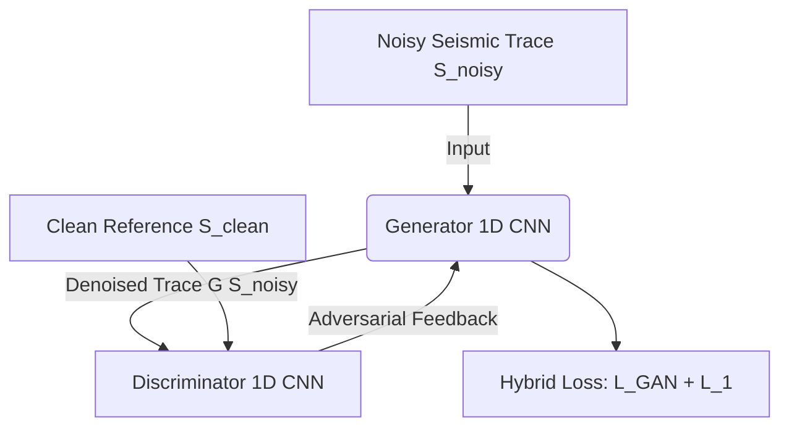

# Seismic GAN Noise Reduction 🧊🤖

A high-performance computational framework for seismic signal noise attenuation using Generative Adversarial Networks (GANs) built in PyTorch. Developed as part of computational geophysics research.

---

## 🎯 Motivation & Practical Importance

In seismic exploration and reflection seismology, field data recordings are heavily contaminated by various types of noise (e.g., ambient ground roll, swell noise, random background interference). High noise levels degrade the **Signal-to-Noise Ratio (SNR)**, obscuring subtle reflections, fault boundaries, and thin-bed stratigraphy.

Traditional filtering methodologies (such as bandpass filters, f-k filtering, or wavelet transforms) often suffer from trade-offs between noise suppression and signal distortion—frequently blurring sharp seismic arrivals or phase signatures. 

Applying **Generative Adversarial Networks (GANs)** to seismic processing allows for:
* **Feature-preserving attenuation:** Removing non-coherent noise while preserving primary reflection amplitudes and phase.
* **Non-linear mapping:** Learning complex data distributions beyond traditional linear filter assumptions.
* **Enhanced subsurface imaging:** Improving velocity model building, migration accuracy, and downstream reservoir characterization.

---

## 🏗️ Architecture & Data Flow (GAN Pipeline)

The workflow follows an adversarial learning paradigm tailored for 1D seismic time series data:



## 🧠 Theoretical Background

This project integrates classical wave propagation models with generative deep learning primitives:

### 1. Synthetic Seismic Modeling (Ricker Wavelet)
The acoustic wave propagation source impulse is modeled using a zero-phase **Ricker Wavelet**, defined as the second derivative of a Gaussian function:

$$A(t) = (1 - 2\pi^2 f_M^2 t^2) e^{-\pi^2 f_M^2 t^2}$$

Where $f_M$ represents the dominant frequency and $t$ is the time vector. Controlled additive Gaussian noise $N(0, \sigma^2)$ is added to simulate degraded acquisition traces:

$$S_{noisy}(t) = A(t) + \eta(t)$$

### 2. Generative Adversarial Architecture (1D GAN)
The denoising architecture consists of two competing networks trained in an adversarial framework:
* **Generator (G):** A 1D Convolutional Autoencoder designed to extract multi-scale spatial-temporal features and reconstruct a clean version of the seismic trace.
* **Discriminator (D):** A 1D Convolutional Classifier acting as a critic to differentiate between clean ground-truth waveforms and denoised outputs from G.

### 3. Hybrid Optimization Objective
To prevent structural blurring and phase shifts common in standard GAN training, a hybrid loss function combining Adversarial Loss ($L_{GAN}$) and Pixel-wise $L_1$ Reconstruction Loss ($L_{L1}$) is minimized:

$$L_{G} = L_{GAN}(G, D) + \lambda \cdot L_{L1}(G)$$

Where $L_{L1} = \vert{}\vert{} S_{clean} - G(S_{noisy}) \vert{}\vert{}_1$ forces strict amplitude and phase alignment with the original wavelet.

---

## 🛠️ What Was Implemented (Pipeline Overview)

1. **Synthetic Data Generation (`generate_synthetic_data.py`):**
   * Implemented custom Ricker wavelet generation algorithms.
   * Synthesized noisy traces and exported visual comparison figures.

2. **Deep Learning Core (`models/`):**
   * Designed `SeismicGenerator1D` (Convolutions + ReLUs) for high-fidelity signal reconstruction.
   * Designed `SeismicDiscriminator1D` (LeakyReLU + Adaptive Pooling) for critical loss estimation.

3. **Automated Training Pipeline (`train.py`):**
   * Built an end-to-end training loop with combined adversarial and $L_1$ reconstruction losses using the Adam optimizer.

4. **Exploratory Notebook (`notebooks/seismic_gan_exploration.ipynb`):**
   * Interactive environment for testing models and visualizing results.

---

## 📊 Visual Results

Synthetic seismic trace generated with $f_M = 25\text{ Hz}$ overlaid with synthetic Gaussian noise:


---

## 📂 Repository Structure

```text
├── data/                      # Sample or synthetic seismic traces & plots
├── models/                    # PyTorch architectures (Generator & Discriminator)
│   ├── generator.py
│   └── discriminator.py
├── notebooks/                 # Exploratory data analysis & training steps
│   └── seismic_gan_exploration.ipynb
├── utils/                     # Signal processing and plotting functions
├── generate_synthetic_data.py # Script for synthetic Ricker wavelet generation
├── train.py                   # GAN training pipeline with combined losses
└── README.md                  # Detailed project documentation

---

## 🛠️ Tech Stack
* **Language:** Python
* **Deep Learning:** PyTorch (1D Convolutional Neural Networks)
* **Geophysics & Math:** NumPy, SciPy, Matplotlib
* **Version Control & Execution:** Git, GitHub, Google Colab

---

## 📚 References & Scientific Literature

1. **Ricker, N.** (1953). *The form and laws of propagation of seismic wavelets*. Geophysics, 18(1), 10-40.
2. **Goodfellow, I., et al.** (2014). *Generative adversarial nets*. Advances in Neural Information Processing Systems (NeurIPS), 27.
3. **Isola, P., et al.** (2017). *Image-to-image translation with conditional adversarial networks* (Pix2Pix framework for paired L1 loss). IEEE CVPR.
4. **Siahkoohi, A., et al.** (2019). *Seismic data denoising using generative adversarial networks*. SEG Technical Program Expanded Abstracts.

---

## 🤝 Acknowledgments & Declaration

* **Computational Infrastructure:** Model training, execution, and experimental validation were carried out using **Google Colab** (GPU computing environment).
* **Version Control & Repository:** Project codebase, history, and deployment are managed via **Git** and hosted on **GitHub**.
* **AI Assistance:** **Gemini (Google AI, version 2.5)** was used as an auxiliary tool to organize the primary idea provided by the author, structure the documentation, and translate text from Portuguese to English.


## 👩‍💻 Author
**Yana Pinheiro**
* M.Sc. Candidate in Geophysics at CPGF-UFPA (CNPq scholar).
* Focus: Computational Geophysics, Machine Learning & Seismic Signal Processing.
