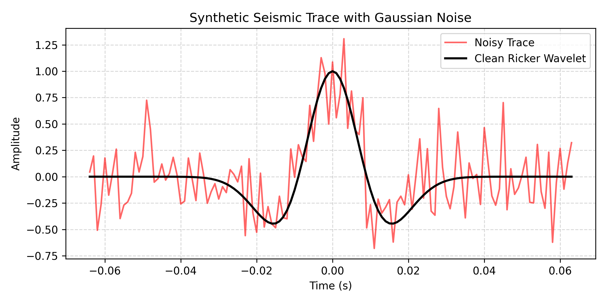

# Seismic GAN Noise Reduction 🧊🤖

A preliminary computational framework for applying Generative Adversarial Networks (GANs) to attenuate noise in seismic data, developed as part of computational geophysics research.

## 🚀 About
This repository contains experimental scripts and pipeline structures developed to test generative neural network architectures (PyTorch) for signal enhancement and random noise reduction in geophysical datasets.

## 📊 Synthetic Data & Visual Results
The script `generate_synthetic_data.py` simulates a clean Ricker wavelet and adds controlled Gaussian noise to test processing workflows:



## 📂 Repository Structure

```text
├── data/                      # Sample or synthetic seismic traces & plots
├── models/                    # PyTorch architectures (Generator & Discriminator)
├── notebooks/                 # Exploratory data analysis & training steps
├── utils/                     # Signal processing and plotting functions
├── generate_synthetic_data.py # Script for synthetic Ricker wavelet generation
├── train.py                   # GAN training pipeline with combined losses
└── README.md                  # Project documentation
